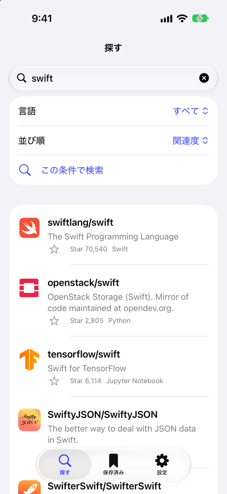
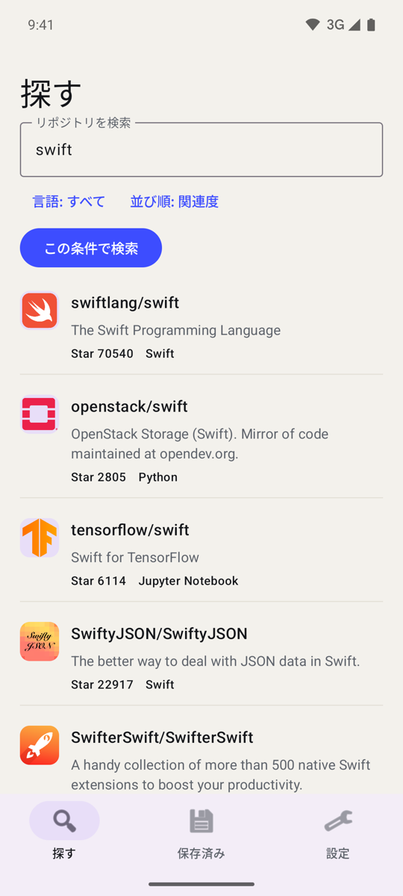
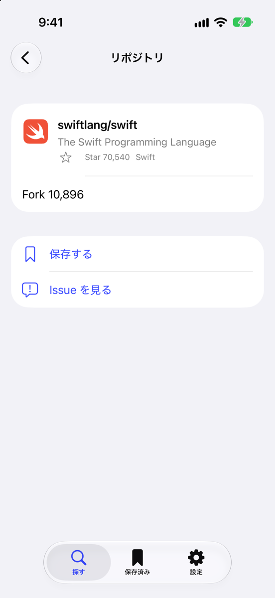
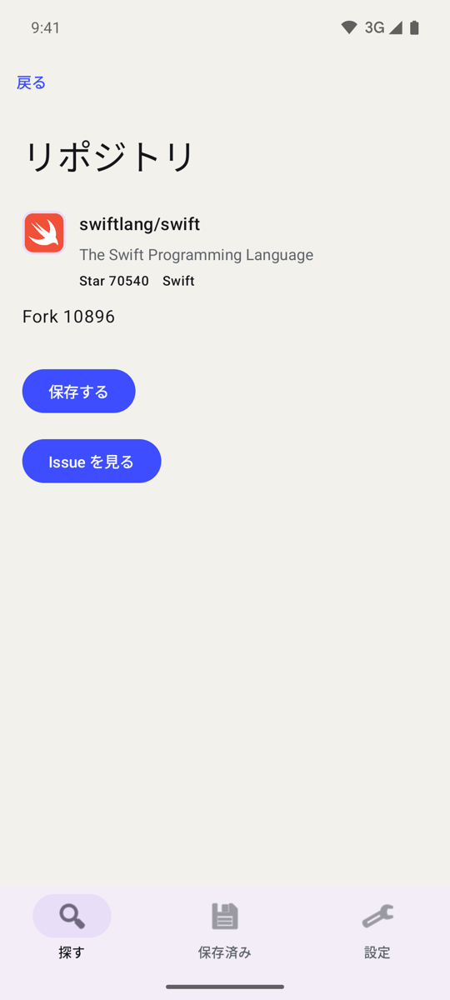
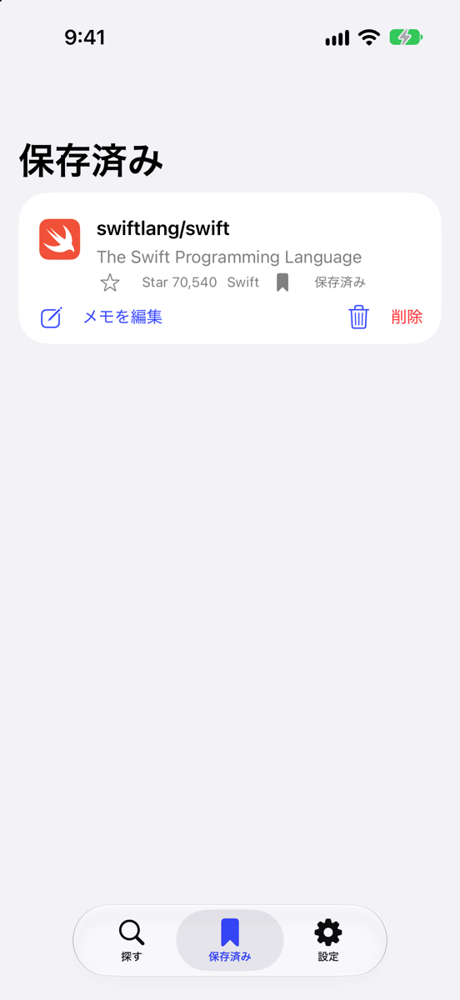
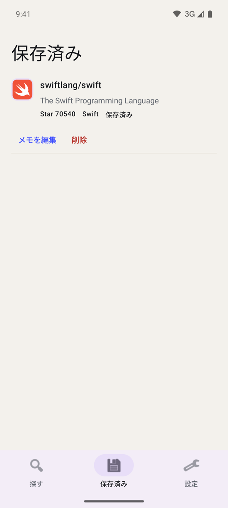
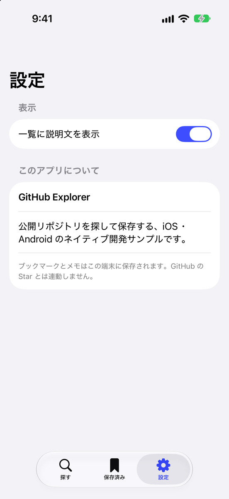
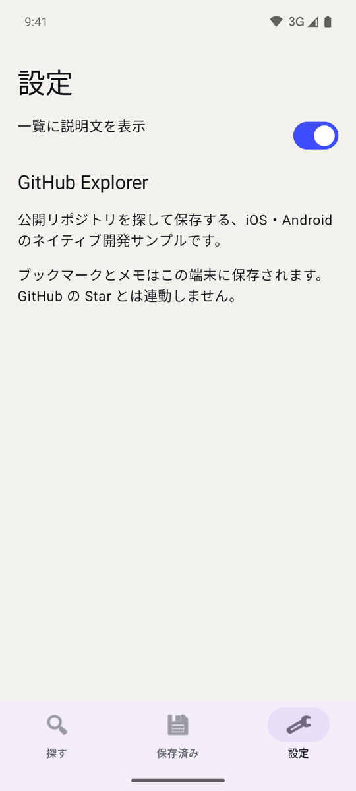
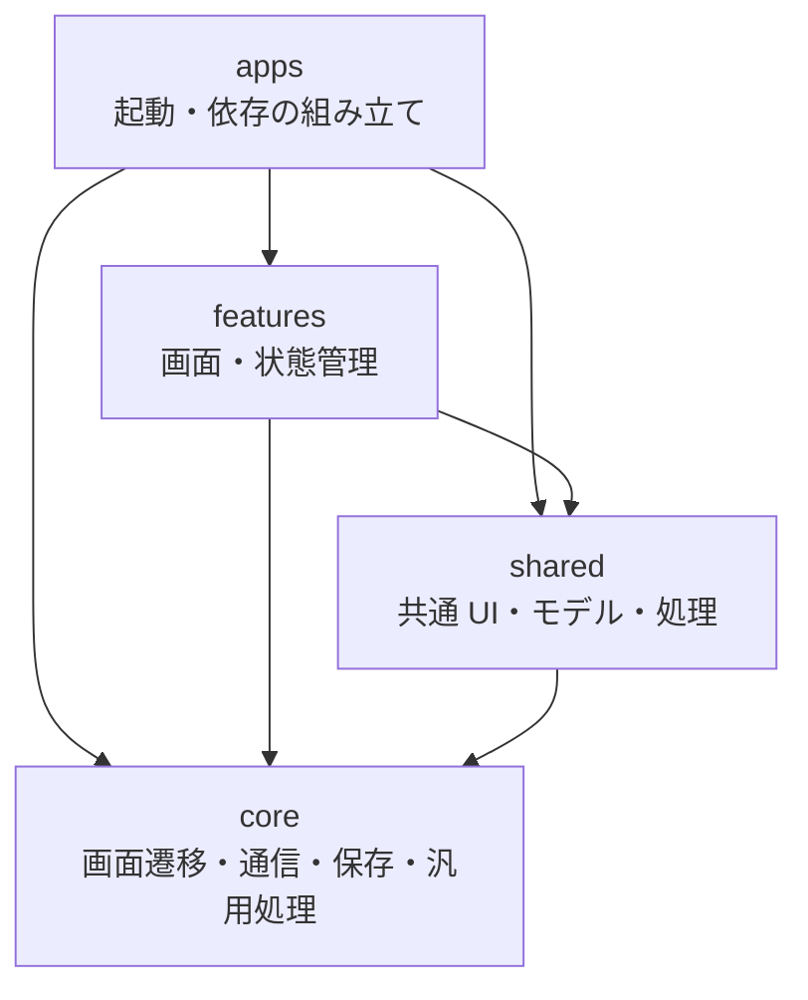

# native-sync-template

[English](README.md)

iOS（Swift）と Android（Kotlin）をネイティブで開発するモノレポのテンプレートです。実装は OS ごとに持ち、共通仕様・コード生成・CI の検査で整合を保ちます。

サンプルアプリは GitHub のリポジトリ・Issue の閲覧、ブックマークとメモの端末内保存、3 タブで共有する表示設定を備えています。SwiftUI と Jetpack Compose を使い、MVVM の構造を両 OS で揃えています。

## 画面

同じ状態（日本語・ライト）の iOS（SwiftUI）と Android（Jetpack Compose）のサンプルアプリです。

| 画面 | iOS | Android |
| --- | --- | --- |
| 探す |  |  |
| リポジトリ詳細 |  |  |
| 保存済み |  |  |
| 設定 |  |  |

見た目の違いは各 OS の標準部品によるものです。機能と構造は各モジュールの `spec.md` でそろえています。

## セットアップ

[mise](https://mise.jdx.dev/getting-started.html) をインストールし、シェル連携を設定してから実行します。

```sh
mise install
mise run setup
```

固定バージョンの開発ツールと依存を取得し、APM でエージェント用スキルを配置します。生成されるエージェント設定はコミットしません。

ネイティブのビルドには、iOS は macOS・Xcode・XcodeGen、Android は JDK 17・Android SDK 36 が必要です。ビルドと実行方法は [iOS](docs/platforms/ios.md)・[Android](docs/platforms/android.md) のガイドを参照してください。

## ディレクトリ構成

| パス | 役割 |
| --- | --- |
| `apps/ios`, `apps/android` | 起動・依存の組み立て・画面遷移の配線 |
| `modules/core` | 基盤処理と汎用ユーティリティ |
| `modules/shared` | 各 OS 内で複数 feature が使う UI・モデル・処理 |
| `modules/features` | 検索・ブックマーク・設定 |
| `specs` | OpenAPI・デザイントークン・画面・翻訳・共通シナリオの定義 |
| `tools` | コード生成とリポジトリの検査 |
| `docs` | 開発ガイドと設計判断 |

各モジュールは `spec.md`・`ios/`・`android/` を持ち、仕様を両 OS の実装の基準にします。

## アーキテクチャ

両 OS のネイティブ実装を同じ構造に揃えます。矢印は依存の方向です。モジュールごとの制限は[依存ルール](AGENTS.md#rules)を参照してください。



## 開発の流れ

1. モジュールの `spec.md` と、関連する `specs/` の定義を更新する。
2. 両 OS を同じ型名・構造で実装し、意図した差分は spec に記録する。
3. `bun tools/check-spec-sync.ts --update both <module-path>` で追従を記録する。
4. 検査を通し、両 OS の変更を 1 つの PR にまとめる。

| コマンド | 用途 |
| --- | --- |
| `mise run generate` | `specs/` から Swift/Kotlin とネイティブリソースを再生成 |
| `mise run check` | 整形・型・tools のテスト・仕様追従・依存・生成物・シナリオを検査 |
| `mise run lint` | Swift/Kotlin の変更後に SwiftLint・ktlint を実行 |
| `mise run fmt` | TypeScript のツールと設定を整形 |

生成物は手で編集しません。PR と `main` への push では CI が検査と lint を実行し、ネイティブのビルドは手動で起動します。

## 詳細ドキュメント（英語）

- [開発ガイド](docs/development.md): アーキテクチャ・生成・テスト・CI
- [設計判断](docs/adr): 設計の背景
- [エージェント向けルール](AGENTS.md)と[プロジェクトのスキル](.apm/skills): 開発規約と作業手順
