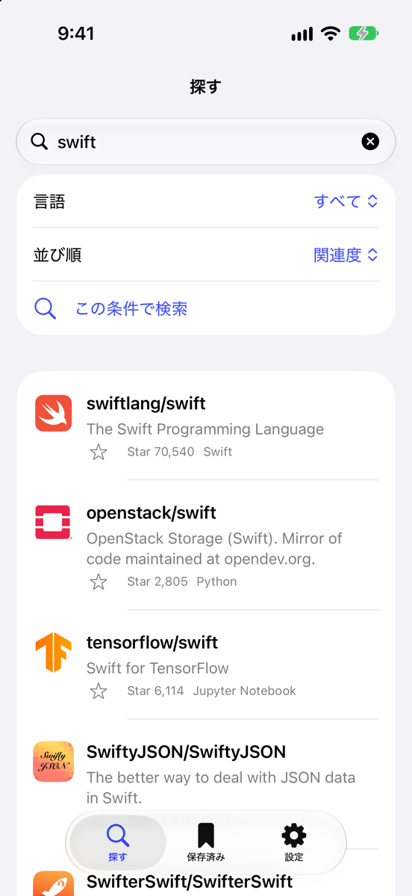
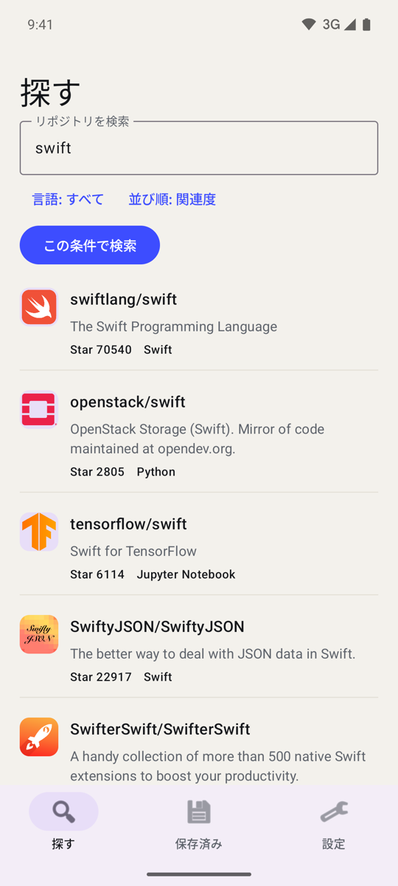
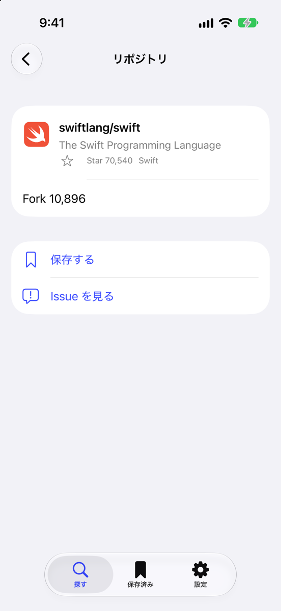
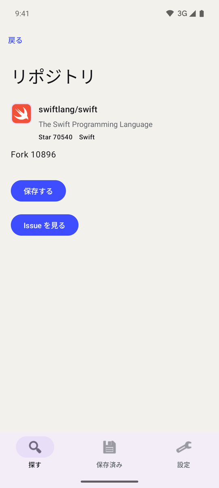
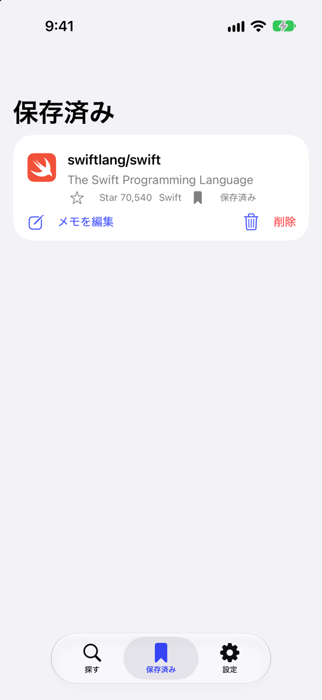
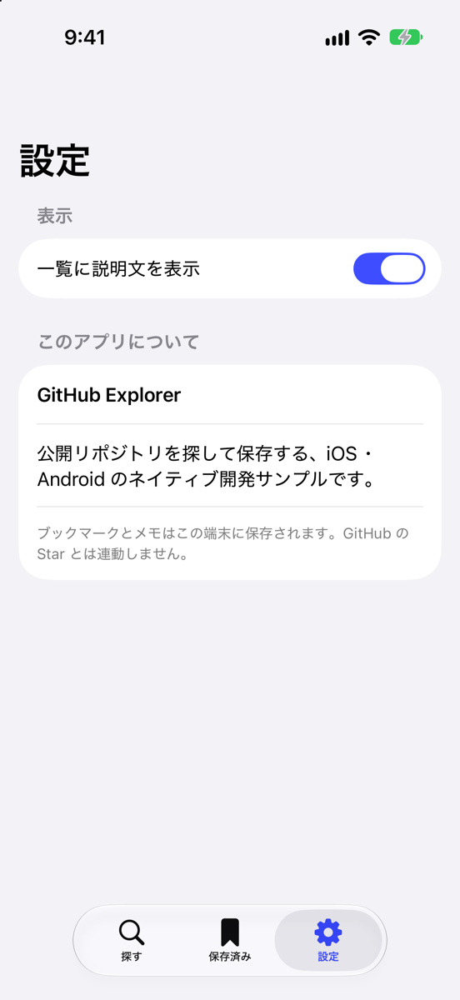
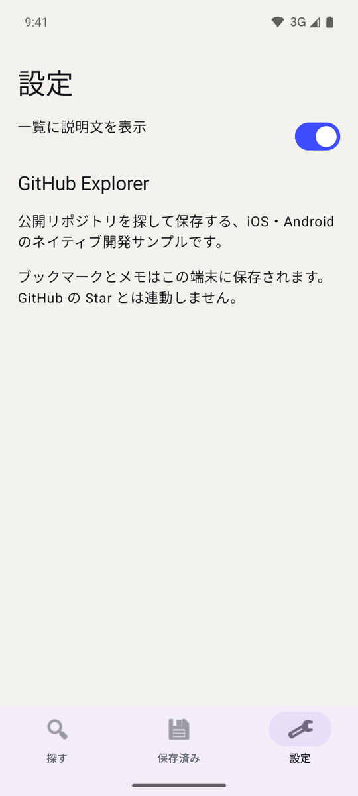
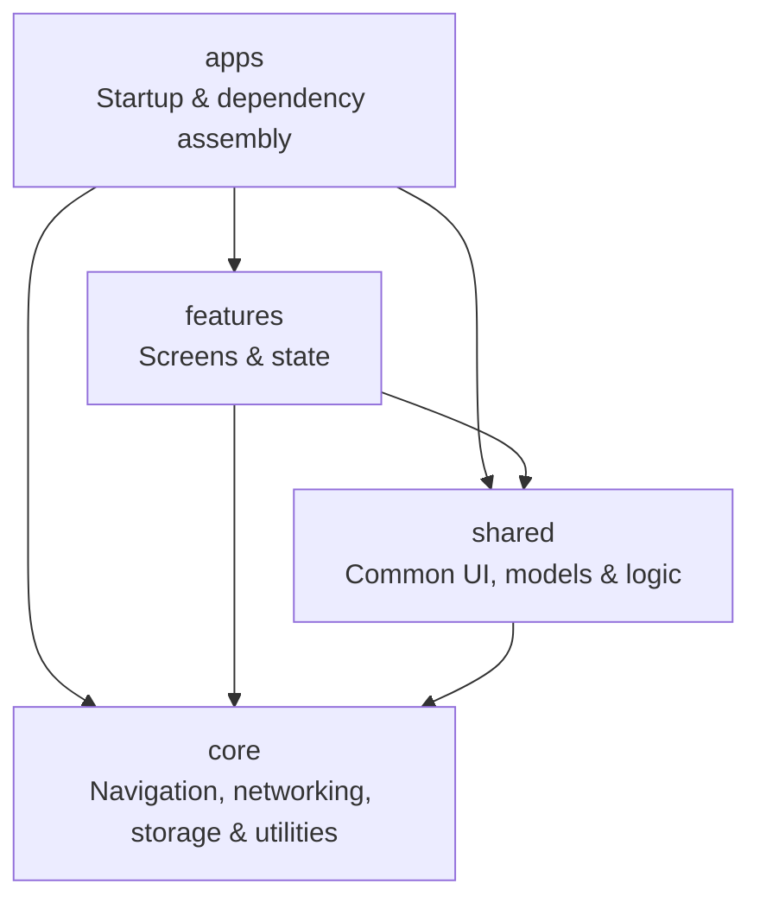

# native-sync-template

[日本語](README.ja.md)

A monorepo template for native iOS (Swift) and Android (Kotlin) apps. Each platform has its own implementation, kept aligned through shared specifications, generated contracts, and CI checks.

The sample app browses GitHub repositories and issues, saves bookmarks and notes locally, and shares display settings across three tabs. It uses SwiftUI and Jetpack Compose, with matching MVVM structures.

## Screenshots

The iOS (SwiftUI) and Android (Jetpack Compose) sample apps, in the same state: Japanese, light appearance.

| Screen | iOS | Android |
| --- | --- | --- |
| Search |  |  |
| Repository details |  |  |
| Saved |  |  |
| Settings |  |  |

Visual differences come from each platform's standard components. Behavior and structure are aligned through each module's `spec.md`.

## Setup

Install and activate [mise](https://mise.jdx.dev/getting-started.html), then run:

```sh
mise install
mise run setup
```

This installs the pinned development tools and dependencies and deploys agent skills through APM. Generated agent configuration is not committed.

Native builds also require Xcode and XcodeGen on macOS for iOS, or JDK 17 and Android SDK 36 for Android. See the [iOS](docs/platforms/ios.md) and [Android](docs/platforms/android.md) guides for build and run instructions.

## Repository layout

| Path | Purpose |
| --- | --- |
| `apps/ios`, `apps/android` | App startup, dependency assembly, and routing |
| `modules/core` | Platform infrastructure and general utilities |
| `modules/shared` | UI, models, and logic shared across features on each platform |
| `modules/features` | Search, bookmarks, and settings |
| `specs` | OpenAPI, design tokens, routes, localization, and shared scenarios |
| `tools` | Code generation and repository checks |
| `docs` | Development guides and architecture decisions |

Each module contains `spec.md`, `ios/`, and `android/`. Its specification is the source of truth for both implementations.

## Architecture

Both native implementations follow this structure. Arrows show dependency direction; see [dependency rules](AGENTS.md#rules) for module-specific restrictions.



## Development

1. Update the module's `spec.md` and any affected definitions in `specs/`.
2. Implement both platforms with matching types and structure. Document intentional platform differences in the spec.
3. Record alignment with `bun tools/check-spec-sync.ts --update both <module-path>`.
4. Run the checks and include both implementations in one PR.

| Command | Purpose |
| --- | --- |
| `mise run generate` | Regenerate Swift/Kotlin code and native resources from `specs/` |
| `mise run check` | Check formatting, types, tooling tests, spec alignment, dependencies, generated files, and scenarios |
| `mise run lint` | Run SwiftLint and ktlint after Swift/Kotlin changes |
| `mise run fmt` | Format TypeScript tooling and configuration |

Do not edit generated files by hand. CI runs repository checks and lint on PRs and pushes to `main`; native builds are triggered manually.

## Further reading

- [Development guide](docs/development.md): architecture, generation, tests, and CI
- [Architecture decisions](docs/adr): design rationale
- [Agent instructions](AGENTS.md) and [project skills](.apm/skills): contribution rules and workflows
