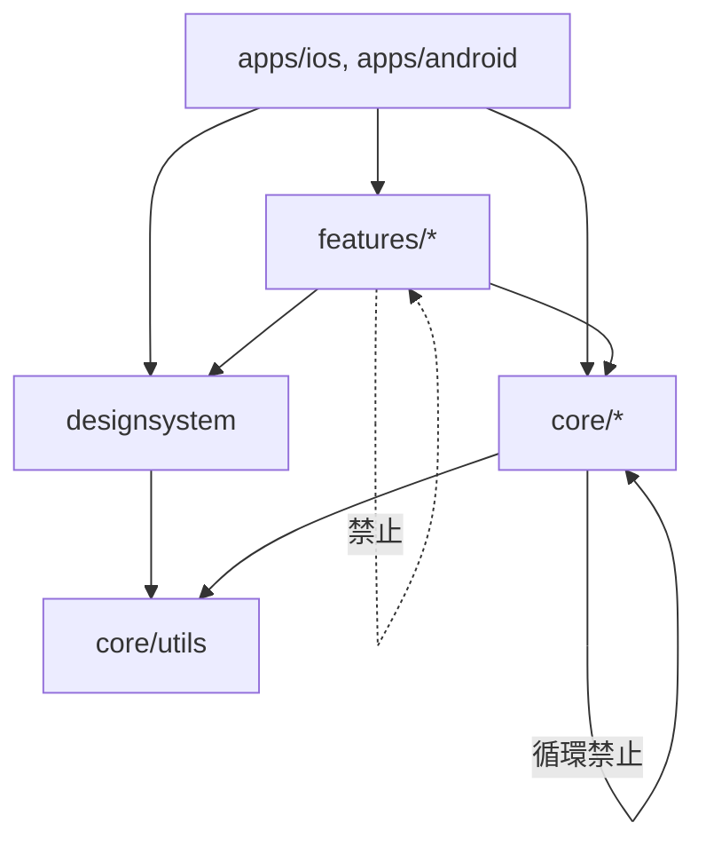
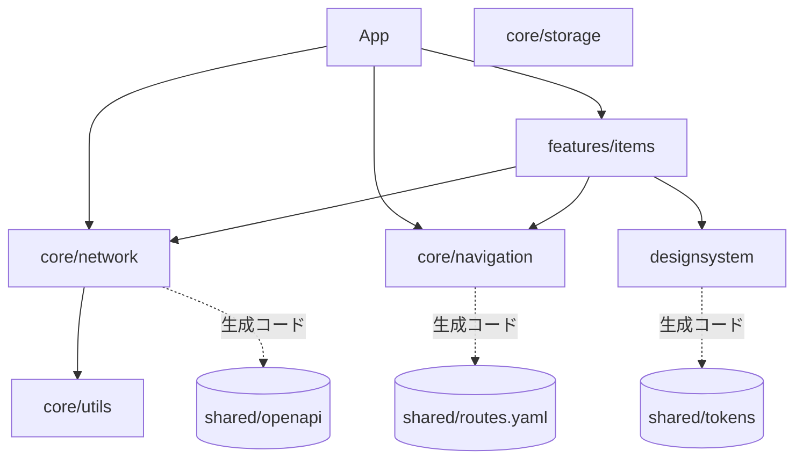

# native-sync-template

iOS（Swift）と Android（Kotlin）をそれぞれネイティブで実装し、**仕様だけを共有して両 OS の同期を保つ**ためのモノレポの雛形です。

- ロジックは OS ごとに書きます。共有するのは API スキーマ（OpenAPI）、デザイントークン、機能仕様（`spec.md`）、共通シナリオだけです。
- 両 OS で同じ型名・同じ構造にそろえ、ズレは CI の検査で見つけます。
- AI エージェント向けのルールは [AGENTS.md](AGENTS.md)、手順はスキル（`.apm/skills/`）にまとめています。

## 目次

1. [セットアップ](#セットアップ)
2. [ディレクトリ構成](#ディレクトリ構成)
3. [開発の流れ](#開発の流れ)
4. [アーキテクチャ](#アーキテクチャ)
5. [共通定義からの生成と検査](#共通定義からの生成と検査)
6. [コマンド一覧](#コマンド一覧)
7. [CI](#ci)
8. [現状](#現状)

## セットアップ

clone 後に一度だけ実行します。

1. mise と apm（Agent Package Manager）をインストールします。どちらも各自で入れます。

   ```bash
   brew install mise apm                      # macOS
   curl https://mise.run | sh                 # Linux（mise）
   curl -sSL https://aka.ms/apm-unix | sh     # Linux（apm）
   ```

   mise のシェル連携（`mise activate`）は [mise のドキュメント](https://mise.jdx.dev/getting-started.html)に沿って設定してください。

2. `mise.toml` に書いたバージョンの Bun・ktlint・SwiftLint（macOS のみ）を入れます。

   ```bash
   mise install
   ```

3. 型定義などの依存を取得し、エージェント用のスキルを配置します。

   ```bash
   mise run setup            # bun install と bun tools/setup.ts（中身は apm install）
   ```

   `.apm/skills/` の原本が `.claude/skills/` と `.agents/skills/` に配置されます（どちらもコミットしません）。
   あわせて `apm.yml` の依存（共通の `apm-shared`、Android 公式の `android/skills`、SwiftUI Pro スキル）も配置されます。
   あわせて MCP 設定（`.mcp.json`、`.codex/config.toml`）と `apm.lock.yaml` も生成されますが、すべてコミットしません（`.gitignore` 済み）。

ネイティブのビルドには、iOS は Xcode（macOS）、Android は Android SDK が必要です。Lint に使う SwiftLint と ktlint は手順 2 の `mise install` で入ります。

## ディレクトリ構成

```
apps/
  ios/                  iOS アプリ（XcodeGen）。モジュールを組み立てるだけ
  android/              Gradle のルートと app モジュール。組み立てるだけ
shared/
  openapi/              API スキーマ（単一の正）
  tokens/               デザイントークン（単一の正）
  scenarios/            両 OS のテストが実装する共通シナリオ
  routes.yaml           画面の一覧（画面遷移の単一の正）
  third-party.yaml      外部ライブラリの両 OS 対応表
modules/
  Package.swift         全 iOS モジュールをまとめた SwiftPM パッケージ
  core/
    utils/              何にも依存しない汎用コード
    navigation/         画面遷移の状態と操作（Route は routes.yaml から生成）
    network/            OpenAPI から生成した API クライアントとそのラッパー
    storage/            UserDefaults / DataStore、Keychain / Keystore
  designsystem/         トークンから生成した値と共通 UI
  features/
    items/              サンプル機能（一覧と詳細）
tools/                  コード生成と検査のスクリプト（Bun / TypeScript）
docs/adr/               設計判断の記録
```

`modules/` の各モジュールは次の形です。`spec.md` が両 OS の同期の基準です。テストは実装とは別のディレクトリに置きます。

```
modules/features/items/
  spec.md                                  仕様（同期の基準）
  ios/
    Sources/FeatureItems/                  実装
    Tests/FeatureItemsTests/               テスト（Swift Testing）
  android/
    build.gradle.kts
    src/main/kotlin/com/example/featureitems/   実装
    src/test/kotlin/com/example/featureitems/   テスト（JUnit）
```

## 開発の流れ

機能を追加・変更するときは、次の順に進めます（詳しくは [AGENTS.md](AGENTS.md) とスキル `sync-feature`）。

1. `spec.md` を更新する。必要なら `shared/` の OpenAPI・トークン・シナリオも更新する。
2. 片方の OS を実装する。
3. もう片方を同じ型名・同じ構造で実装する。意図した違いは `spec.md` の「OS 固有の差分」に書く。
4. `bun tools/check-spec-sync.ts --update both <モジュールのパス>` で追従を記録する。
5. 検査を通し、両 OS の変更を 1 つの PR にまとめる。

## アーキテクチャ

両 OS とも「MVVM + 単方向データフロー」と、Presentation / Domain / Data の 3 層でそろえます。TCA のように片方の OS にしかないフレームワークは使わず、両 OS の公式機能で同じ形を作ります。対応関係が 1 対 1 であるほど、AI による移植とレビューが正確になります。

### モジュール内のレイヤー

| レイヤー | 責務 | iOS の型 | Android の型 |
| --- | --- | --- | --- |
| Presentation | 画面と画面状態 | `ItemsView` + `ItemsViewModel`（`@Observable`） | `ItemsScreen` + `ItemsViewModel`（`StateFlow`） |
| Domain | ビジネスルール、モデル、Repository の契約 | `ItemsUseCase`、`protocol ItemsRepository` | `ItemsUseCase`、`interface ItemsRepository` |
| Data | Repository の実装、API・DB の型との変換 | `ItemsRepositoryImpl` | `ItemsRepositoryImpl` |

型名とファイル名は両 OS で同じにします。各レイヤーは自分より内側にだけ依存できます（Presentation → Domain ← Data）。サンプルの `features/items` は小さいため、今は ViewModel と View だけで構成しています。

### モジュール間の依存ルール

| モジュール | 依存してよい先 |
| --- | --- |
| `apps/*` | すべて（DI の組み立てと画面遷移の配線だけを持つ） |
| `features/*` | `core/*`、`designsystem`（**features 同士は禁止**。画面遷移は `core/navigation` のルート定義を経由する） |
| `core/*` | 他の `core/*`（循環は禁止） |
| `core/utils` | なし（標準ライブラリの拡張など、機能を知らないコードだけ） |
| `designsystem` | `core/utils` |

依存してよい向き（矢印は「依存する」）:



現在のモジュール（iOS と Android で同じ形）:



点線は依存ではなく、`tools/generate.ts` による生成元です。`core/storage` はまだ使う機能がないため、単独で置いています。

`bun tools/check-deps.ts` が、このルールと、iOS と Android の依存関係が一致していることを検査します。外部ライブラリは `core/*` のラッパーからだけ使い、`shared/third-party.yaml` に両 OS の対応を書きます（AndroidX・Kotlin・kotlinx は対象外）。

### 画面遷移

画面遷移は 1 通りだけです（[ADR 0002](docs/adr/0002-navigation.md)）。機能の中でも外でも、すべて `core/navigation` の `Navigator` に `Route` を渡して遷移します。`NavigationLink` などで画面を直接開きません。

- 画面の一覧（名前・引数・タブ・ディープリンク）は `shared/routes.yaml` に書き、`bun tools/generate.ts` で両 OS の `Route` と `AppTab` を生成します。
- 遷移は `NavigationState`（タブごとのスタックと、重なったモーダル）として持ち、7 つの操作で書き換えます。
- スタックの要素は `NavigationEntry(id, route)` です。同じ Route を複数回開いても別の ID を持ち、戻る操作やタブ切り替えでは残った画面の ID を保ちます。タブの先頭エントリは `NavigationState.roots` が保持します。
- URL から開くときは `Route(url:)` / `Route.fromUrl` を使います。エンコード済みパスを区切ってから一度だけデコードするため、ID に `/` や `%` が含まれていても保たれます。

| 操作 | 使いどころ |
| --- | --- |
| `push(route)` / `pop()` / `popToRoot()` | 一覧 → 詳細、戻る、先頭まで戻る（モーダル表示中はモーダルの中で） |
| `present(route, style)` / `dismiss()` | ハーフシート（`sheet`）・全画面モーダル（`fullScreen`）と、それを閉じる |
| `selectTab(tab)` | タブ切り替え（モーダルは閉じる） |
| `reset(state)` | ログイン後のホームなど戻れない遷移、ディープリンク（`NavigationState.opening`） |

`Route` から画面への対応と状態の描画はアプリ層だけが持ちます（iOS: `apps/ios/App/AppMain.swift`・`RootView.swift`、Android: `MainActivity.kt`・`AppRoot.kt`）。描画には iOS は `TabView` / `NavigationStack` / `.sheet`、Android は `NavigationSuiteScaffold` / Navigation 3 / ボトムシートを使い、タブバーや大画面のレイアウトは OS の部品に任せます。画面を足したら、`routes.yaml` に 1 件、アプリ層の対応に 1 行足します（足し忘れは `switch` / `when` の網羅チェックでビルドが落ちます）。

### 技術スタック

| 領域 | iOS | Android |
| --- | --- | --- |
| UI | SwiftUI（必要な箇所だけ UIKit） | Jetpack Compose |
| 状態管理 | Observation（`@Observable`） | ViewModel + StateFlow |
| 非同期 | Swift Concurrency | Kotlin Coroutines / Flow |
| DI | イニシャライザ注入（必要なら swift-dependencies） | Hilt |
| 通信 | 生成クライアント + URLSession | 生成クライアント + HttpURLConnection |
| キー・値の保存 | UserDefaults | DataStore |
| 秘密情報の保存 | Keychain | Keystore で暗号化して DataStore |
| 構造化データの保存 | SwiftData | Room |
| ユニットテスト | Swift Testing | JUnit + kotlinx-coroutines-test |
| UI テスト | XCUITest | Compose UI Test |
| 静的解析 | SwiftLint / swift-format | ktlint / detekt |

DI、構造化データの保存、UI テスト、静的解析は方針だけで、テンプレートにはまだ組み込んでいません。

### 最低対応バージョン（案）

- **iOS 18 以上**: Observation と SwiftData を前提にできます。Liquid Glass（iOS 26）などの新しい API は `#available` で分岐し、`designsystem` の中に閉じ込めます。
- **Android minSdk 28 以上**: targetSdk は常に最新にします。
- リリース時期が決まった時点で、利用者の OS 分布を見て見直します。

## 共通定義からの生成と検査

### OpenAPI から API クライアントを生成する

`bun tools/generate.ts` が `shared/openapi/openapi.yaml` から、`core/network` に次のコードを生成します。生成先の `Generated/`（iOS）と `generated/`（Android）は手で編集しません。

| 生成物 | iOS | Android |
| --- | --- | --- |
| schema ごとの DTO | `struct ItemDTO: Codable` | `@Serializable data class ItemDTO` |
| operation ごとのメソッド | `APIClient.listItems()` | `ApiClient.listItems()` |

- DTO とクライアントは `core/network` の内部（`internal`）に閉じます。手書きの `DefaultItemsAPI` / `DefaultItemsApi` がドメインモデル（`Item`）に変換して公開します。
- 通信は `HTTPTransport` / `HttpTransport` で差し替えられます。テストではスタブを渡します。
- 生成器が対応する OpenAPI の範囲は `tools/lib/openapi.ts` の先頭に書いてあります。範囲外の構文は生成時にエラーになります。

同じコマンドで、`shared/tokens/tokens.json` から `designsystem` の `Tokens`（色・余白）を、`shared/routes.yaml` から `core/navigation` の `Route`・`AppTab`・ディープリンクの解析も生成します。

### 共通シナリオを両 OS のテストで実装する

`shared/scenarios/*.yaml` の各 step に `id` を付け、両 OS のテストに `// @scenario <シナリオ名>/<id>` と書きます。`bun tools/check-scenarios.ts` は次を検査します。

- すべての step が、iOS と Android の両方のテストから参照されている
- `given` の operationId が OpenAPI にあり、2xx の `body` がレスポンスの schema に合っている（`navigation` は画面遷移の初期状態として予約）
- 機能の `spec.md` がシナリオを参照している

### spec と実装の追従を記録する

各モジュールの `ios/.spec-sync` と `android/.spec-sync` に、その OS が追従した `spec.md` のハッシュを記録します。`bun tools/check-spec-sync.ts` は、片方でも古ければ失敗します。

## コマンド一覧

検査ツールは Bun（TypeScript）で書いています。外部の npm パッケージは使わず、YAML・TOML の読み込みとテストは Bun の組み込み機能を使います（`package.json` の依存は型検査用の `typescript` と `@types/bun` だけです）。依存の取得は `.npmrc` と `bunfig.toml` で制限しています（公式レジストリのみ、ライフサイクルスクリプトを実行しない、バージョンは固定、公開から 7 日未満のバージョンは入れない）。CI では `bun audit` で既知の脆弱性も検査します。

| 目的 | コマンド |
| --- | --- |
| PR ごとの検査をすべて実行（CI の `repo-checks` と同じ） | `mise run check` |
| トークンと OpenAPI から Swift / Kotlin を生成 | `bun tools/generate.ts` |
| spec と両 OS の同期を検査 | `bun tools/check-spec-sync.ts` |
| 追従を記録 | `bun tools/check-spec-sync.ts --update both modules/features/items` |
| モジュールの依存ルールを検査 | `bun tools/check-deps.ts` |
| 生成コードが最新かを検査 | `bun tools/check-generated.ts` |
| 共通シナリオと両 OS のテストの対応を検査 | `bun tools/check-scenarios.ts` |
| tools/ 自体のテスト | `bun test tools/tests` |
| tools/ の型検査 | `bun x tsc --noEmit` |
| tools/ の整形（`bun fmt`。設定は `bunfig.toml`） | `mise run fmt` |
| Swift と Kotlin の Lint | `mise run lint` |
| iOS のテスト（Xcode / macOS） | `cd modules && xcodebuild test -scheme Modules-Package -destination 'platform=iOS Simulator,name=iPhone 16'` |
| Android のテスト（Android SDK と JDK 17 が必要。Gradle は wrapper で 8.14.3 に固定） | `cd apps/android && ./gradlew test` |
| iOS アプリのプロジェクト生成 | `cd apps/ios && xcodegen generate` |
| スキルの原本を変更したあとの再配置 | `apm install` |

iOS のテストは iOS Simulator 上で実行します。iPhone 16 の Simulator がない場合は、`xcrun simctl list devices available` で利用できる機種名を確認し、`name=` を置き換えてください。`swift test` はホストの macOS 向けにビルドするため、このパッケージのテストには使いません。

## CI

| ワークフロー | タイミング | 内容 |
| --- | --- | --- |
| CI（`repo-checks`） | すべての PR と main への push | `mise run check`（tools の整形・型検査・テスト、spec の同期、依存ルール、生成差分、共通シナリオの検査。Linux、数秒） |
| CI（`lint`） | すべての PR と main への push | SwiftLint と ktlint（Linux）。生成コードは対象外 |
| CI（`actions-lock`） | すべての PR と main への push | ワークフローの `uses:` が `actions.lock` と一致するか（`gh actions-lock --verify`） |
| Native build | 手動（Actions タブの「Run workflow」） | iOS: Simulator で全モジュールのテストとアプリ本体のビルド / Android: `./gradlew test assembleDebug` |

ネイティブのビルドは時間とコストがかかるため、最初は手動にしています。

### アクションの固定（actions.lock）

ワークフローで使うアクションは、GitHub 公式の lockfile `.github/workflows/actions.lock` で固定しています。各 `uses:` のタグが指すコミットを（アクションが内部で使うアクションも含めて）記録し、実行時はそのコミットだけが動きます。タグを書き換えられても、記録と違うコミットは実行されません。

- `uses:` を追加・変更したら、手元で `gh actions-lock` を実行し、ワークフローと `actions.lock` の差分を確認してコミットします。手で編集しないでください。
- 拡張は `gh extension install github/gh-actions-lock --pin v0.4.0` で入れます（CI と同じバージョン）。
- `uses:` には `@v4` ではなく `@v4.4.0` のように正確なバージョンを書きます（`gh actions-lock` も書き換えます）。
- Docker イメージ（`docker run` や `container:`）とスクリプトでのダウンロードは対象外です。
- lockfile のない状態での実行を禁止するには、リポジトリの設定で「Require lockfile」ポリシーを有効にします。

## 現状

- **実装済み**: 共通定義（OpenAPI のサンプル、トークン、シナリオ）、トークンと OpenAPI からの Swift / Kotlin 生成、`core/utils`・`core/network`・`core/storage`・`core/navigation`（画面遷移）、サンプル機能 `items`（一覧と詳細）、同期・依存・生成差分・シナリオの検査、CI。
- **未実装**: 外部 SDK を使うラッパーモジュールのサンプル（対象の SDK を検討中）。
- アプリには API サーバーが無いため、フェイクの `ItemsAPI` を使っています。実サーバーができたら `DefaultItemsAPI(transport: URLSessionTransport(baseURL:))` / `DefaultItemsApi(UrlConnectionTransport(baseUrl))` に差し替えます。
