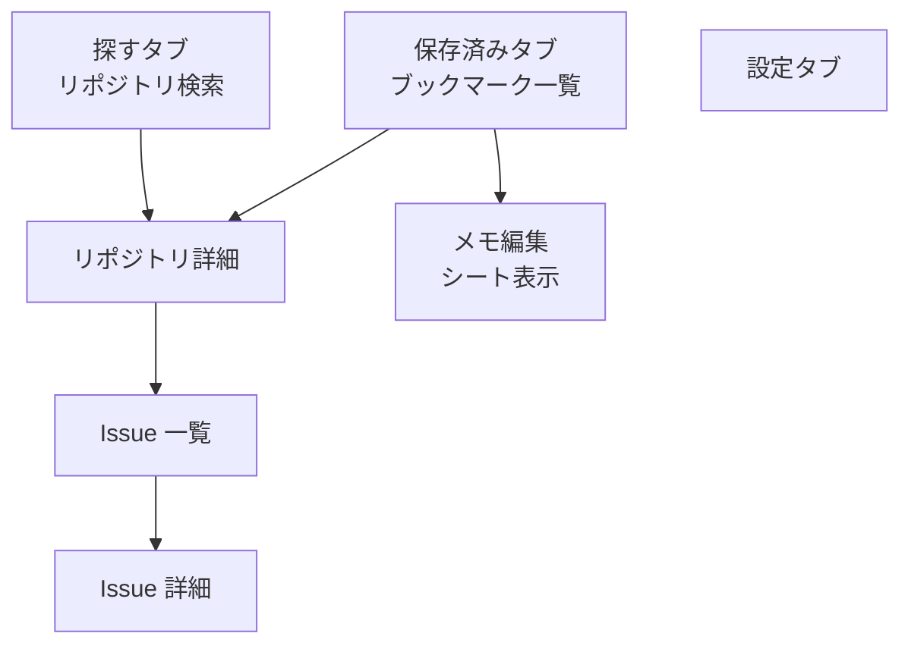

# GitHub サンプルアプリ実装計画

作成日: 2026-11-03

既存の `items` サンプルを、公開リポジトリを探して保存する GitHub 閲覧アプリに置き換える。検索、一覧、詳細、タブ、シート、入力、端末内保存、実 API 通信を、iOS と Android で同じ仕様・同じ構造で示す。

2026-11-03: 最新main `3603193` を基点に実装へ移行。型定義不足は `bun install --frozen-lockfile` による依存復元で解消し、着手前の65テストと `mise run check` が成功した。以下を実装・検証の基準とする。

## 1. 初期実装の範囲

- 公開リポジトリの検索、言語による絞り込み、並べ替え、ページング。
- リポジトリ詳細と、そのリポジトリの Issue 一覧・詳細。
- アプリ独自のブックマークとメモ。GitHub の Star 操作とは別の機能として端末内に保存する。
- 設定画面から一覧の説明文表示を切り替え、再起動後も設定を保持する。
- 通常起動では GitHub REST API を利用する。プレビュー・共通シナリオ・自動テストでは固定レスポンスを注入する。
- 読み込み中、空、失敗、再試行、取得済みデータを残した更新、追加読み込み失敗を再現できるようにする。

初期実装に認証、非公開リポジトリ、GitHub への書き込み、ユーザー専用画面、コメント投稿は含めない。Issue 本文はプレーンテキストで表示し、README・完全な Markdown 表示は後続の拡張候補とする。

## 2. 画面と遷移

### 全体構成

タブは「探す」「保存済み」「設定」の 3 つ。通常画面 6 つと、メモ編集シート 1 つで構成する。



「探す」と「保存済み」からは同じリポジトリ詳細画面を開き、保存状態も連動する。タブごとの閲覧履歴を保持し、設定を開いて元のタブへ戻ったときは、見ていた詳細画面を再表示する。

この構成で、リスト、画像、検索、選択 UI、タブ、画面遷移、シート、フォーム、確認ダイアログ、ローカル保存の実装例を示す。

### 画面ごとの要素と Route

画面は `shared/routes.yaml` に定義し、各モジュールの `spec.md` に画面と遷移を書く。以下の Route 名は実装時の採用案とする。設定は `features/settings`、それ以外は `features/github` が担当する。

| 画面 | Route | 表示・操作 | 遷移 |
| --- | --- | --- | --- |
| リポジトリ検索 | `repositorySearch` | 検索欄、言語選択、並べ替え、アバター付き一覧、更新、追加読み込み | 「探す」のルート。選択時に詳細へ `push` |
| リポジトリ詳細 | `repositoryDetail(owner, repo)` | 名前、所有者、説明、言語、Star・Fork 数、トピック、保存ボタン | Issue 一覧へ `push` |
| Issue 一覧 | `repositoryIssues(owner, repo)` | Open／Closed 切り替え、状態バッジ、タイトル、更新日時、ページング | Issue 詳細へ `push` |
| Issue 詳細 | `issueDetail(owner, repo, number)` | タイトル、投稿者、状態、本文 | `pop` で戻る |
| ブックマーク一覧 | `bookmarks` | 保存したリポジトリ、メモの有無、メモ編集、削除確認、空表示 | 「保存済み」のルート。詳細へ `push`、メモ編集を `present(.sheet)` |
| メモ編集シート | `bookmarkNote(repositoryId)` | 複数行入力、文字数、保存、キャンセル、保存エラー | 保存成功またはキャンセルで `dismiss` |
| 設定 | `settings` | 一覧の説明文表示スイッチ、アプリ情報 | 「設定」のルート |

### 共通の挙動

- 遷移は ViewModel から `Navigator` を呼ぶ。Route と画面の対応、タブ・スタック・モーダルの描画はアプリ層で配線する。
- Route にはオブジェクトを渡さない。リポジトリは `owner` と `repo`、Issue はさらに `number`、ブックマークは ID の文字列表現で識別する。
- 検索条件は画面内の Picker／メニューで変更し、検索確定操作で取得する。入力のたびに API を呼ばない。
- 検索画面の初期状態は未検索。サンプル検索語を表示し、選択すれば検索できるようにする。空白だけの検索は送信しない。
- タブ別の戻る履歴を保持する。既存サンプルの画面スコープ、再表示時の再取得抑制、キャンセルの扱いを引き継ぐ。
- 読み上げラベル、文字拡大、画像失敗時の代替表示を用意する。ネイティブ部品による意図した OS 差分は spec に記録する。

## 3. GitHub 公式 OpenAPI の利用

GitHub は [公式リポジトリ `github/rest-api-description`](https://github.com/github/rest-api-description) で OpenAPI 3.0／3.1 の定義を公開している。`api.github.com` 向けに、共通要素を `$ref` で参照する bundled 形式と参照を展開した形式がある。[公式説明](https://docs.github.com/en/rest/about-the-rest-api/about-the-openapi-description-for-the-rest-api)

### 採用方針

1. 初期導入では OpenAPI 3.0 の bundled 形式を使う。REST API の日付バージョンは `2026-03-10` を採用する。OpenAPI の仕様バージョンとは別に管理する。[API バージョンの公式説明](https://docs.github.com/en/rest/about-the-rest-api/api-versions)
2. 導入時に公式定義の実在するコミット SHA とファイルパスを確認し、固定する。取得元 URL、コミット、API バージョン、チェックサムを `shared/openapi` 内のメタデータに記録する。
3. 更新用の Bun スクリプトで、対象 operation と必要な参照を抽出する。選択した公式定義のスナップショットと、利用するフィールド・正規化ルールを `shared/openapi` に保存する。出典と MIT ライセンス表記も保持する。
4. ローカルのスナップショットと選択ルールから、既存の生成入力 `shared/openapi/openapi.yaml` を決定的に生成する。上流のフィールドを別の型へ勝手に置き換えない。対応しない構文を使用する場合は明示的に失敗させる。
5. `tools/generate.ts` にこの処理を組み込み、その後に Swift／Kotlin を生成する。正規化済み OpenAPI とネイティブ生成物は直接編集しない。
6. 上流の取得・更新と、通常の再生成を分離する。通常の生成・CI は保存済み入力だけで動作し、GitHub へアクセスしない。`check-generated.ts` も OpenAPI の中間生成物を検査する。

公式定義を丸ごと生成対象にするとテンプレートの規模が大きくなるため、初期対象は次の 4 operation に限定する。operationId は公式定義の値を維持し、アプリ向けの命名は手書きラッパーで整える。

| 用途 | エンドポイント | operationId | 主な入力 |
| --- | --- | --- | --- |
| リポジトリ検索 | `GET /search/repositories` | `search/repos` | `q`, `sort`, `order`, `page`, `per_page` |
| リポジトリ詳細 | `GET /repos/{owner}/{repo}` | `repos/get` | `owner`, `repo` |
| Issue 一覧 | `GET /repos/{owner}/{repo}/issues` | `issues/list-for-repo` | `owner`, `repo`, `state`, `page`, `per_page` |
| Issue 詳細 | `GET /repos/{owner}/{repo}/issues/{issue_number}` | `issues/get` | `owner`, `repo`, `issue_number` |

検索には言語条件と公開リポジトリ条件を組み込む。検索 API の結果上限は 1,000 件で、`incomplete_results` が返る場合もあるため、全件取得済みと誤認させない。[検索 API](https://docs.github.com/en/rest/search/search)

Issue 一覧 API には Pull Request も含まれる。`pull_request` の有無で除外し、除外後の件数でページの終端を判断しない。PR だけのページでも続きがあれば次ページの取得操作を残す。[Issue API](https://docs.github.com/en/rest/issues/issues#list-repository-issues)

### 現行生成器に必要な対応

現行の `tools/lib/openapi.ts` は object・基本型・配列・schema の `$ref`、path／query パラメータを中心とする小さな生成器。enum・合成型・パラメータ参照などは未対応で、プロパティの省略可否と null 許容も独立して扱っていない。

- 抽出処理で operation のパラメータ参照を解決し、利用するレスポンスフィールドと、その依存 schema を選択する。
- 初期表示に不要な union を取り込まない。特に Issue のラベル詳細は初期対象から外し、状態バッジとリポジトリのトピックでチップ表示の例を持つ。
- 利用する enum の許容値を契約・シナリオ検査に保持する。レスポンスに未知の値が追加された場合の表示方法もラッパーで定義する。
- 必須だが null を許すフィールドと、省略可能なフィールドを区別し、両 OS のデコードと fixture 検証を一致させる。
- GitHub の識別子は `Int64`／`Long` で扱う。`snake_case` の変換、null、未知のレスポンスフィールド、日時文字列を検証する。
- 成功レスポンスのヘッダーを手書きラッパーまで渡せるよう、生成クライアントと通信層の返却形式を拡張する。共有の「最後のレスポンス」に格納する方式は使わず、各呼び出しの結果に付随させる。
- 生成 DTO・APIClient は引き続き `core/network` 内部に閉じる。上流定義の互換性を確認するテストと、抽出・再生成が決定的であることを確認するテストを追加する。

## 4. 通信と状態管理

### HTTP の取り扱い

- ベース URL は `https://api.github.com`。
- `Accept: application/vnd.github+json`、`X-GitHub-Api-Version: 2026-03-10`、アプリを識別できる `User-Agent` を付与する。公開データの参照だけで動く構成にし、トークンの設定を初回起動の前提にしない。
- `HTTPRequest`／`HttpRequest` と `HTTPResponse`／`HttpResponse` にヘッダーを扱う能力を追加する。現在はリクエストごとのヘッダーとレスポンスヘッダーを保持できない。
- `Link` の `rel="next"` をページングの基準にする。ヘッダー名は大文字小文字を区別しない。次ページ情報は `core/network` でアプリ向けの値に変換する。
- エラーにもステータス、必要なヘッダー、分類に必要な情報を保持する。404、検索条件不正、レート制限、その他の 403、サーバー障害、通信失敗を区別する。
- Android の既存の blocking 通信は、タイムアウトとキャンセルを含めて確認する。通信が遅れて完了しても、終了した画面や新しい検索結果を書き換えない。

GitHub の認証なしアクセスは、通常の REST API が IP 単位で毎時 60 回、検索 API が毎分 10 回に制限される。連続操作の抑制とキャッシュを初期実装に含める。[通常の制限](https://docs.github.com/en/rest/using-the-rest-api/rate-limits-for-the-rest-api)、[検索の制限](https://docs.github.com/en/rest/search/search#rate-limit)

レート制限時は `Retry-After`、`X-RateLimit-Remaining`、`X-RateLimit-Reset` とエラー情報を使い、再試行可能になるまで取得操作を抑制する。403 をすべてレート制限とは判断しない。二次制限で待機時間が明示されない場合も最低 1 分待ち、自動で再試行を繰り返さない。[エラー時の公式手順](https://docs.github.com/en/rest/using-the-rest-api/troubleshooting-the-rest-api#rate-limit-errors)

### 画面状態

- 検索条件を変更して確定したら、進行中の旧リクエストをキャンセルし、ページ番号を初期化する。遅れて届いた旧結果も無視する。
- 初回取得、更新、追加読み込みを分ける。更新や追加取得が失敗しても、表示済みの一覧を消さない。
- 同じページの重複取得と ID の重複表示を防ぐ。初期のページサイズは 20 件とする。
- 検索条件・ページ・Issue の状態などを含むキーで、5 分間のメモリキャッシュを持つ。明示的な更新はキャッシュを迂回し、取得制限は守る。時計を注入してテスト可能にする。
- キャンセルはユーザー向けの通信エラーにしない。再表示・Android の構成変更で ViewModel と取得済み状態を無用に作り直さない。

## 5. モジュールとローカル保存

| モジュール | 責務・変更 |
| --- | --- |
| `core/network` | GitHub API の生成物、`GitHubAPI`／`GitHubApi`、手書きラッパー、公開モデル、ページ・エラー情報、HTTP と画像取得の基盤 |
| `core/storage` | 既存の `KeyValueStore` を利用。画面間で共有する表示設定の保存・購読を追加する場合は、その契約もここに置く |
| `core/navigation` | 新しい Route・AppTab を生成。既存の Navigator の操作を利用 |
| `features/github` | 検索・詳細・Issue・ブックマーク・メモ。Presentation／Domain／Data を設け、API と保存処理を Repository 経由にする |
| `features/settings` | 表示設定とアプリ情報。`features/github` へ直接依存しない |
| `designsystem` | 空表示、エラーと再試行、ローディング、状態バッジなどの共通 UI。画像データの取得元には依存しない |
| `apps/ios`, `apps/android` | API・Repository・Store の生成と注入、Route → 画面の対応。検索・保存・エラー判定のロジックは置かない |

- `features/github` のブックマーク Repository をアプリ内で 1 インスタンス共有し、保存状態の変更を検索・詳細・保存済み画面へ通知する。OS ごとの購読手段は spec に記録する。
- ブックマークには安定したリポジトリ ID、`owner/repo`、表示用の最小スナップショット、メモ、保存日時を保持する。保存済み一覧の表示だけでリポジトリを一件ずつ再取得しない。
- 小規模サンプルとして最大 100 件を保存し、`KeyValueStore` にバージョン付き JSON として永続化する。保存処理を直列化し、並行した編集で更新を失わないようにする。
- 保存に失敗したときは成功表示にせず、メモの入力も保持する。メモは空欄可、上限 1,000 Unicode コードポイントとし、両 OS で同じ基準で検証する。
- 表示設定は保存済み一覧にも検索結果にも反映する。設定の保存・購読は共有の契約を通し、feature 同士の依存を作らない。
- アバター画像の取得・キャッシュは `core/network` に閉じ込め、UI へ画像表示に必要なデータを渡す。デモとテストでは空の画像URLを使い、代替表示を確認する。
- 初期実装は既存依存と OS 標準機能を基本とする。外部ライブラリが必要になった場合は `add-third-party` を適用し、core のラッパーと両 OS の対応表を追加する。

## 6. 実装手順

各段階は `sync-feature` に従い、spec・共通定義を先に更新し、iOS → Android の順で同じ型名・構造を実装する。新規モジュールの登録には `add-module` を使う。最終的に両 OS を 1 つの PR にまとめる。

### 着手前に型検査の実行環境を整える

計画作成時の `mise run check` は、`bun x tsc --noEmit` で `TS2688: Cannot find type definition file for 'bun'` が発生し、型検査を通過していない。`package.json` には `@types/bun` が既に定義され、`tsconfig.json` も `types: ["bun"]` を指定しているため、まず依存のインストール状態と型定義の解決先を確認する。

- `mise.toml` で固定された Bun を使い、`bun install --frozen-lockfile` で既存の lockfile に従って依存を復元する。
- `bun x tsc --noEmit` を再実行する。解消しなければ `@types/bun` とその依存の配置・解決経路を調べ、必要な修正を行う。型検査の無効化や `types` の削除で回避しない。
- `mise run check` 全体の成功を確認してから、以下の機能実装に進む。計画作成時に成功した 65 テストと構成検査だけでは、型検査の完了とは扱わない。

### 機能実装

1. **仕様と構成を確定する**
   - `features/github` と `features/settings` の spec を作成し、network・storage・navigation・designsystem の変更も spec に反映する。
   - 画面、検索条件、保存上限、キャッシュ、エラー分類、OS 固有の差分を定義する。
   - 公式 OpenAPI の抽出・固定・更新方針を ADR に記録する。
2. **共通入力と生成を整える**
   - 公式 OpenAPI の固定元、抽出スクリプト、選択ルール、スナップショットを追加する。
   - 生成器・生成物チェック・シナリオ検証を拡張し、null 許容やヘッダーの契約を確認する。
   - `shared/routes.yaml`、必要なデザイントークン、共通シナリオを定義する。
3. **通信と保存の基盤を実装する**
   - 生成クライアントをラップし、ページ情報・エラー情報を公開モデルに変換する。
   - 固定レスポンスの Transport を用意し、実際の DTO デコード・変換を通るテストにする。
   - ブックマークと表示設定の保存・購読を両 OS で実装する。
4. **画面を両 OS に実装する**
   - 検索・詳細 → Issue → 保存済み・メモ → 設定の順で進める。
   - タブ間の状態反映、戻る操作、シート、構成変更、キャンセルを確認する。
5. **アプリを切り替える**
   - iOS の `modules/Package.swift` と `apps/ios/project.yml`、Android の `settings.gradle.kts` と app 依存へ新モジュールを登録する。
   - `AppMain.swift`／`RootView.swift`、`MainActivity.kt`／`AppRoot.kt` で組み立てと画面対応を更新する。
   - 通常起動を実 API に切り替え、テスト・プレビューの固定データ注入を維持する。
6. **旧サンプルを整理する**
   - `features/items`、Items API ラッパー、旧 routes・シナリオ・アプリ内 Fake を新サンプルへ置き換える。
   - `tools/tests` の fixture や検査にも `items` 前提があるため、実リポジトリの構成に依存する箇所を更新する。生成器の汎用テストに使う独立した Item fixture は保持してよい。
   - README の画面構成、実行方法、API 制限、OpenAPI 更新方法、モジュール図を更新する。
7. **追従を記録し、検査する**
   - 実装とテストが揃ったモジュールだけ `.spec-sync` を更新し、下記の検証を通す。

## 7. 共通シナリオと検証

`shared/scenarios` に操作と期待結果を書き、両 OS のテストに `// @scenario <シナリオ名>/<id>` を対応させる。API の揺らぎやレート制限に依存するテストを CI の必須条件にしない。

| 領域 | 必須シナリオ |
| --- | --- |
| 検索 | 成功、0 件、失敗と再試行、空白入力、条件変更、古いレスポンスの無視 |
| ページング | 追加取得、重複 ID、終端、1,000 件上限、不完全な検索結果、失敗後の再試行 |
| 詳細・Issue | nullable な説明・投稿者・本文、404、Open／Closed 切り替え、PR 除外、PR のみのページからの継続 |
| 通信制限 | 403／429、通常の 403 との区別、待機時間の反映、キャッシュ、明示的更新 |
| ブックマーク | 追加・解除、全画面への反映、再起動後の復元、保存上限、保存失敗 |
| メモ・設定 | 入力上限、保存・キャンセル、保存失敗時の入力保持、設定の反映と復元 |
| 画面の寿命 | タブ別履歴、再表示時の重複取得なし、Android の構成変更、画面終了時のキャンセル |

現行の `tools/check-scenarios.ts` は `given` に API operation と `navigation` しか許さず、API fixture も `status`／`body`／`pending` に限られる。実装時にレスポンスヘッダー、必要なエラー body、ローカル保存の初期状態を表す形式を追加し、既存形式も維持する。ローカル保存のシナリオを架空の API operation で代用しない。

実装時の検査コマンド:

```sh
bun tools/generate.ts
mise run fmt
bun tools/check-spec-sync.ts --update both <実装済みのモジュールパス>
mise run check
mise run lint
```

さらに iOS Simulator で全モジュールのテストとアプリのビルド、Android で `./gradlew test assembleDebug` を行う。両 OS で検索 → 詳細 → Issue、保存 → メモ編集 → 再起動、タブ切り替えと戻る操作を確認する。実 API の疎通は少数の手動確認として行い、実データの件数や Star 数を固定値で検証しない。

## 8. 完了条件

- [x] `bun` の型定義不足による TS2688 が解消し、`bun x tsc --noEmit` と `mise run check` 全体が成功する。
- [x] 認証情報の設定なしに、両 OS で公開リポジトリを検索・閲覧できる。
- [x] 3 タブ、通常画面 6 つ、メモ編集シート 1 つを実装し、詳細への push、入力・保存・再試行を一通り操作できる。
- [x] ブックマーク・メモ・表示設定が再起動後も復元される。
- [x] 公式 OpenAPI の固定元と更新手順が追跡でき、オフラインで再生成して差分が出ない。
- [x] 生成された型が `core/network` から漏れず、feature 間の直接依存がない。
- [x] 共通シナリオを両 OS が実装し、意図した OS 差分が spec に記録されている。
- [x] 必須検査と両 OS のテスト・ビルドが通り、README とアプリが新サンプルに一致している。


## 9. 実装結果と検証記録（2026-11-03）

- `codex/github-sample` は取得した最新main `3603193` を基点に作成。
- 旧 `features/items`、Items API、旧シナリオ・テスト・アプリ内Fakeを削除し、READMEとモジュール追加スキルの例も更新。
- GitHub公式定義は `6348fd455a44a445f9e37a505e981b2c3ed24046` に固定。4 operationと必要フィールドを抽出し、オフライン生成に対応。
- `bun` 型定義は依存復元で解消。型検査・toolsの76テスト・37共通シナリオステップ・依存境界・spec追従を検証。
- `mise run check` は変更内容をコピーしてコミットした一時リポジトリで全項目成功。さらにPR作成時、コミット `17c819b` の作業ツリーでも全項目成功した。
- `mise run lint`、iOS Simulatorでの全Swiftモジュールテストとアプリビルド、Androidの `./gradlew test assembleDebug` を実施。
- iOSの実画面で、検索 → 詳細 → Issue一覧 → Issue詳細、PRだけのページからの継続、保存 → メモ入力 → 保存・再表示、設定の全一覧への反映、タブ別履歴保持を確認。実GitHub APIでも4 operationの疎通を確認した。
- 通常起動で保存したブックマーク・メモ・表示設定を、アプリ終了・再起動後に復元できることをiOSで確認。保存基盤の再生成テストも両OSで実施。
- Androidの実画面操作・構成変更は、この時点では未確認。2026-11-04に物理端末で確認した結果を次節に記載する。

## 10. Android実機確認（2026-11-04）

対象はPixel 8a、Android 17（API 37）、コミット `17c819b` のDebug APK。MacからUSB接続し、通常起動の実GitHub APIで確認した。APKのSHA-256は `568d211f6894f07d3ed4c825edb984747f1dc6d2f90088e71b165c8bc9cb1eb6`。

| 確認項目 | 結果 |
| --- | --- |
| 検索 → リポジトリ詳細 | `swift` の検索結果から `swiftlang/swift` を開き、説明・Star・Forkを表示 |
| 検索0件 | 存在しない検索語で「結果がありません」と条件変更の案内を表示し、通信エラーとは区別されることを確認 |
| Issue一覧 → 詳細 | 追加読み込み、Open / Closedの切り替え、Issue本文と投稿者の表示、Androidの戻る操作を確認 |
| ブックマーク | 詳細で保存し、保存済みタブへ反映。削除確認のキャンセルで保持し、削除確定で空一覧になることを確認 |
| メモ | 入力・保存・再表示・キャンセルを確認 |
| 構成変更 | メモ入力中に横向きへ回転しても入力とシートを保持。シート展開後に保存でき、横向きではタブがナビゲーションレールに切り替わる |
| タブ別の履歴 | メモ編集中の回転とタブ切り替えを挟んでも、「探す」のIssue詳細を保持 |
| 表示設定 | 説明文を非表示にすると保存済み一覧へ反映 |
| プロセス終了後の復元 | `am force-stop` 後のコールド起動で、ブックマーク・メモ・説明文の非表示設定を復元 |
| クラッシュ | 検証中のアプリのクラッシュ・ANRは確認されず、終了履歴には検証用のforce-stopのみを記録 |

**確認した表示上の問題（未修正）**: 端末のダークモードが有効な場合、アプリは明るい背景のままステータスバーの時刻・通信アイコンが白く表示され、コントラストが不足する。検索・Issue詳細・設定画面で再現した。

検証で変更した端末の回転設定は元の縦向き固定へ戻した。検証用ブックマーク・メモは削除操作で消去し、アプリの説明文表示も初期値へ戻した。Android SDKのADB 37.0.1がMac上で断続的に終了するため、検証専用ポートとLIBUSBバックエンドを使用した。USBデバッグの再認証後に検索0件の追加確認も完了した。最後にアプリを初期検索画面へ戻し、端末上の検証用画面ダンプを削除した。
